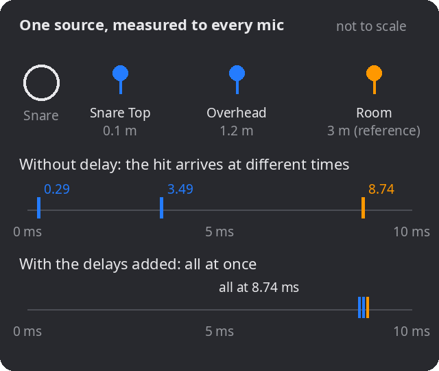
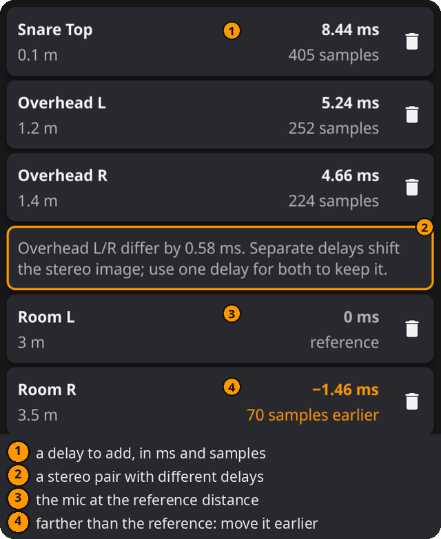

# Alignment Delay

How much delay does each close mic need, so that a sound arrives in all your mics at the same time?

## When to use it

- Drums recorded with close mics, overheads and room mics: line the close mics up with the overheads or the room.
- An amp with a close mic and a room or "far" mic.
- Any source picked up by several mics at different distances, live or in the studio.

## How it works

Sound travels at about **343 m/s** at 20 °C, so it needs about **2.9 ms per metre**. A mic 3 m from the snare hears the hit 8.44 ms after a mic 0.1 m away. Mixed together, the two copies arrive at different times: the hit gets smeared, and some frequencies cancel (see **Two-Mic Sum**).

*When the hit arrives: before and after adding the delays.*

The calculator delays every close mic by exactly the time the sound needs to travel the extra distance to the **reference mic**, the mic farthest from the source:

- **delay = (reference distance − mic distance) ÷ speed of sound**
- **speed of sound ≈ 331.3 + 0.606 × temperature (°C)** m/s

The samples are the delay times the sample rate, rounded to whole samples.

**One source at a time.** All distances must be measured from the **same** source. The room mic is at a different distance from the snare than from the kick, so one calculation lines up the arrivals of one source. Delaying a mic for the snare also shifts everything else it picks up.

## How to use it

1. **Check the Setup card:**
   - **Source**: the sound source you measure from, e.g. Snare. Type a name, or tap the arrow for common sources.
   - **Temperature** (°C/°F): the room's temperature; it sets the speed of sound.
   - **Reference mic**: the distance from the source to the reference mic, usually the room mic, in m or ft. This unit is used for every distance.
   - **Sample rate**: your project's sample rate.
2. **Add the close mics:** type a name or pick one with the arrow, enter its distance from the source ("From snare"), and press **+**.
3. **Read the delay to add** on each mic card, and enter it in your DAW (a track delay or a time-adjust plug-in).

The Setup card starts open with Snare, 20 °C, 3 m and 48 kHz, and folds into one line once the first mic is added. Tap the trash icon on a card to remove a mic.

## Reading the results

- **Each mic card** shows the mic's distance on the left, and the **delay to add** in ms and samples on the right.
- **0 ms · reference**: the mic is at the reference distance; it needs no delay.
- **A negative value in amber**, e.g. −1.46 ms · 70 samples earlier: the mic is *farther* than the reference. A delay can't make it earlier. Move its track earlier by that amount in the DAW, or make it the reference instead.
- **Pair note:** when a stereo pair (e.g. Overhead L and R) gets different delays, an amber note shows the difference. Delaying the two sides differently changes the timing between them and moves the stereo image; give both the same delay to keep it.

## In practice

1. **Choose the source** you care most about lining up; for drums usually the snare, sometimes the kick.
2. **Measure from the source** to every mic capsule with a tape measure: to the snare's top head, not to the stand. A few centimetres don't matter (1 cm ≈ 0.03 ms).
3. **Pick the reference:** usually the farthest mic you keep in the mix, often the room. Everything is delayed to line up with it.
4. **Enter the delays** in your DAW, as a track delay or with a time-adjust plug-in on each close mic.
5. **Check in mono:** solo the close mic with the reference, switch the delay on and off, and listen. The aligned version usually sounds fuller and punchier in the low end.
6. **Fine-tune by ear or by eye:** zoom in on a hit in both tracks and compare. The calculation gets you close; the waveforms show the rest.

Keep standard setups as **presets** in the **⋮** menu: Save as…, Load, Manage, and Import/Export to move them between computers and phones. A preset stores the source, distances, units, sample rate and mics, but not the temperature.

## Examples

Distances from the snare, 20 °C, reference 3 m, 48 kHz:

| Mic | Distance | Delay to add |
|---|---|---|
| Snare Top | 0.1 m | 8.44 ms (405 samples) |
| Overhead L | 1.2 m | 5.24 ms (252 samples) |
| Overhead R | 1.4 m | 4.66 ms (224 samples) |
| Room L | 3 m | 0 ms (reference) |
| Room R | 3.5 m | −1.46 ms (70 samples earlier) |

The overheads differ by 0.58 ms, so the pair note appears.

## Good to know

- **It's an estimate.** It assumes sound travels straight from the source to each mic. Reflections, the source's size and the mics' own delays aren't included, so confirm by ear.
- **Not every mic should be aligned.** A room mic's later arrival gives the sense of space; lining it up perfectly can make the room sound smaller. Treat alignment as an option to try.
- Use **Two-Mic Sum** to see what a time difference does to the sound, and **3:1 Rule** to check how strongly a source spills into another mic.
