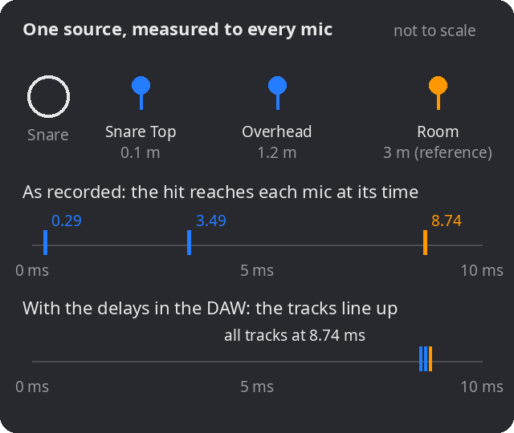
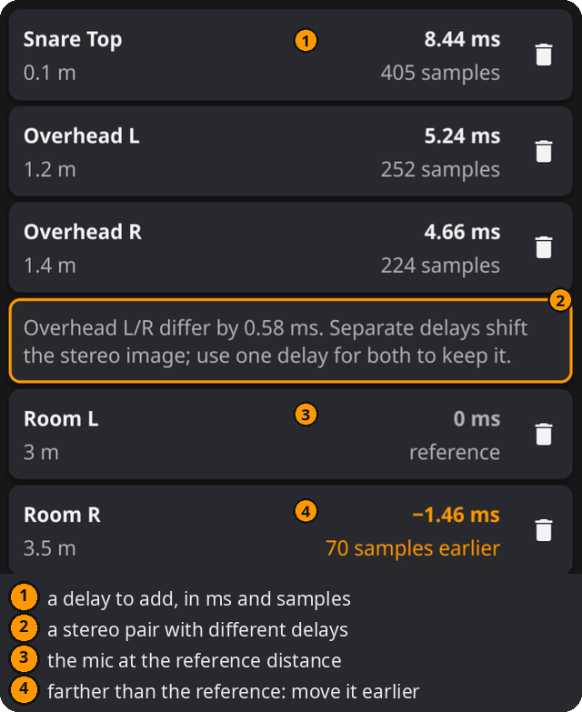

# Laufzeitausgleich

Wie viel Verzögerung benötigen die nahen Mikrofone, damit der Schall einer Quelle an allen Mikrofonen gleichzeitig ankommt?

## Einsatz

- Nahmikrofone eines Schlagzeugs an Overheads oder Raummikrofone angleichen.
- Nah- und Raummikrofon eines Verstärkers angleichen.
- Eine mit mehreren Mikrofonen in verschiedenen Abständen aufgenommene Quelle im Studio oder live ausrichten.

## Funktionsweise

Schall bewegt sich bei 20 °C mit ungefähr **343 m/s**, also mit rund **2.9 ms pro Meter**. Ein Mikrofon 3 m von der Snare hört einen Schlag 8.44 ms nach einem Mikrofon in 0.1 m Abstand. Beim Mischen können dadurch Transienten verschmieren und Frequenzen ausgelöscht werden; siehe **Zwei-Mikrofon-Summe**.

*Ankunft des Schlags vor und nach dem Laufzeitausgleich. Die Abbildung verwendet englische Beschriftungen.*

Für jedes Nahmikrofon berechnet der Rechner die Verzögerung, die seinen kürzeren Weg zum **Referenzmikrofon**, meist dem entferntesten Mikrofon, ausgleicht:

- **Verzögerung = (Referenzabstand − Mikrofonabstand) ÷ Schallgeschwindigkeit**
- **Schallgeschwindigkeit ≈ 331.3 + 0.606 × Temperatur (°C)** in m/s

Die Sampleanzahl ist Verzögerung × Samplerate, auf ganze Samples gerundet.

**Immer eine Schallquelle betrachten.** Alle Abstände müssen von derselben Quelle gemessen sein. Der Abstand des Raummikrofons zur Snare unterscheidet sich vom Abstand zur Bassdrum. Ein Ausgleich richtet daher die Ankunft einer Quelle aus und verschiebt zugleich alle anderen Signalanteile dieses Mikrofons.

## Bedienung

1. Die Karte **Aufbau** prüfen:
   - **Schallquelle:** etwa Snare; frei eingeben oder über den Pfeil auswählen.
   - **Temperatur** in °C/°F bestimmt die Schallgeschwindigkeit.
   - **Referenzmikrofon:** Abstand von der Quelle zum Referenzmikrofon in m oder ft. Diese Einheit gilt für alle Abstände.
   - **Samplerate:** Samplerate des Projekts.
2. **Nahmikrofone hinzufügen:** Namen eingeben oder wählen, Abstand zur Quelle eintragen und **+** drücken.
3. Die **Verzögerung** jeder Mikrofonkarte in der DAW als Spurverzögerung oder mit einem Time-Adjust-Plug-in einstellen.

Der Aufbau beginnt geöffnet mit Snare, 20 °C, 3 m und 48 kHz. Nach dem ersten Mikrofon klappt er zusammen. Das Papierkorbsymbol entfernt ein Mikrofon.

## Ergebnisse

- Jede Karte zeigt links den Abstand und rechts die nötige Verzögerung in ms und Samples.
- **0 ms · Referenz:** Kein Ausgleich nötig.
- Ein **negativer gelber Wert**, etwa −1.46 ms und 70 Samples früher, bedeutet: Dieses Mikrofon ist weiter entfernt als die Referenz. Eine positive Verzögerung kann es nicht vorziehen. Die Spur entsprechend früher verschieben oder dieses Mikrofon als Referenz verwenden.
- **Stereohinweis:** Zwei Mikrofone mit gleichem Grundnamen und Endung L/R oder Left/Right, etwa Overhead L/R, werden als Paar erkannt. Unterscheiden sich ihre Verzögerungen um mindestens ein Sample, erscheint ein gelber Hinweis. Getrennte Verzögerungen verändern das Stereobild; eine gemeinsame Verzögerung erhält es.

*Die Abbildung verwendet englische Beschriftungen.*

## Praxis

1. Die wichtigste **Schallquelle** wählen, beim Schlagzeug oft Snare oder Bassdrum.
2. Mit einem Maßband von der **Quelle zur Mikrofonkapsel** messen, nicht zum Stativ. Ein Zentimeter entspricht etwa 0.03 ms oder 1.4 Samples bei 48 kHz.
3. Meist das entfernteste im Mix verwendete Mikrofon als **Referenz** wählen.
4. Die berechneten Verzögerungen in der **DAW** einstellen.
5. **In Mono prüfen:** Nahmikrofon und Referenz solo abhören und den Ausgleich ein- und ausschalten. Ausgerichtet kann es straffer und voller klingen, muss aber nicht besser sein.
6. **Nach Gehör oder Wellenform verfeinern:** Einen Schlag in beiden Spuren vergrößern und den tatsächlichen Versatz vergleichen. Die Rechnung ist ein Ausgangspunkt.

Standardaufbauten lassen sich im **⋮**-Menü als **Presets** speichern, laden, verwalten und zwischen Geräten importieren/exportieren. Ein Preset enthält Quelle, Abstände, Einheiten, Samplerate und Mikrofone, aber keine Temperatur.

## Beispiele

Von der Snare gemessen, 20 °C, Referenz 3 m, 48 kHz:

| Mikrofon | Abstand | Verzögerung |
|---|---|---|
| Snare Top | 0.1 m | 8.44 ms (405 Samples) |
| Overhead L | 1.2 m | 5.24 ms (252 Samples) |
| Overhead R | 1.4 m | 4.66 ms (224 Samples) |
| Room L | 3 m | 0 ms (Referenz) |
| Room R | 3.5 m | −1.46 ms (70 Samples früher) |

Die Overheads unterscheiden sich um 0.58 ms; deshalb erscheint der Stereohinweis.

## Hinweise

- **Es ist ein Schätzwert.** Das Modell nimmt direkte Schallausbreitung an. Reflexionen, Quellengröße und eigene Mikrofonverzögerungen fehlen. Nach Gehör bestätigen.
- **Nicht jedes Mikrofon sollte ausgerichtet werden.** Die spätere Ankunft eines Raummikrofons kann zum räumlichen Eindruck gehören. Perfekter Ausgleich kann den Raum kleiner wirken lassen.
- **Zwei-Mikrofon-Summe** zeigt die Folgen eines Zeitunterschieds. Die **3:1-Regel** prüft das Übersprechen zu einem anderen Mikrofon.
