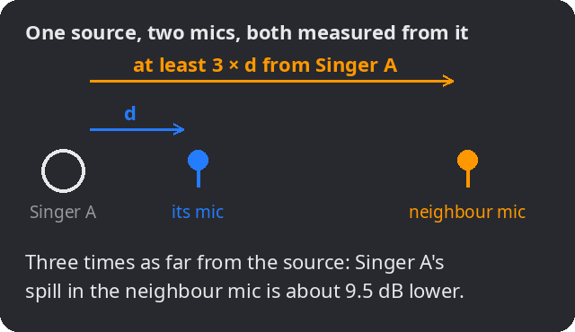
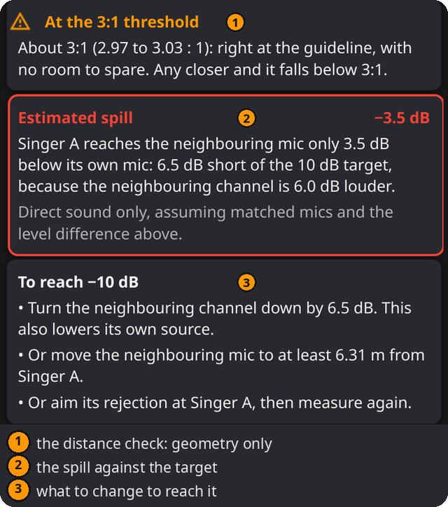

# 3:1-Regel

Überspricht eine Schallquelle zu stark auf ein Nachbarmikrofon? Falls ja: Wie viel leiser oder weiter entfernt muss dieses Mikrofon sein?

## Einsatz

- Zwei Sänger, zwei Instrumente oder ein Chor mit jeweils eigenen Mikrofonen.
- Gitarrenverstärker und Gesang im selben Raum.
- Nahe beieinander stehende Mikrofone für unterschiedliche Quellen, die zusammengemischt werden.

## Funktionsweise

Jedes Mikrofon nimmt auch andere Quellen auf: **Übersprechen**, auch Spill oder Bleed. Erreicht dieselbe Quelle ihr eigenes Mikrofon und später und leiser ein Nachbarmikrofon, entsteht beim Mischen eine verzögerte Kopie und damit Kammfilterung; siehe **Zwei-Mikrofon-Summe**. Je leiser die Kopie, desto flacher der Kammfilter.

*Die Abbildung verwendet englische Beschriftungen.*

Im Freifeld, fern von Wänden und bei einer im Vergleich zum Abstand kleinen Quelle, fällt der Schalldruck proportional zu 1 ÷ Abstand (die Intensität mit 1 ÷ Abstand²): um ungefähr **6 dB bei jeder Verdopplung des Abstands**. Nahe großer Quellen und in halligen Räumen fällt er weniger. Je weiter das Nachbarmikrofon relativ zum eigenen entfernt ist, desto leiser das Übersprechen:

- **Übersprechen** ≈ 20 × log10(Abstand zum eigenen Mikrofon ÷ Abstand zum Nachbarmikrofon) + **Pegel des Nachbarkanals**
- Bei **dreifachem Abstand** liegt es rund **9.5 dB** tiefer. Das ist die klassische **3:1-Regel**. Im einfachen Modell bleibt die Kammfilterung damit bei höchstens etwa +2.5 / −3.5 dB.

Viele Anleitungen formulieren die Regel stattdessen über den Mikrofonabstand: Die Mikrofone stehen mindestens dreimal so weit auseinander wie jedes von seiner Quelle. Das ist nicht dieselbe Geometrie. Der Rechner verwendet die beiden Wege von der Quelle, die den Übersprechpegel bestimmen: Mit dem eigenen Mikrofon bei d und dem Nachbarmikrofon bei 3 × d auf einer Linie stehen die Mikrofone nur 2 × d auseinander; 3 × d Mikrofonabstand auf dieser Linie ergeben 4 × d zur Quelle, also −12.0 dB.

Der **Pegel des Nachbarkanals** berücksichtigt zusätzliche Verstärkung, Faderstellung, Empfindlichkeit oder Richtwirkung. Das ist deine Schätzung; der Rechner kennt Mikrofone und Fader nicht. Ein hoher Nachbarpegel kann eine geometrisch gute Aufstellung problematisch machen; ein niedriger kann eine enge Aufstellung entschärfen. Er ist nur der zusätzliche Kanalpegel; die Abnahme mit dem Abstand wird berechnet. In der **Zwei-Mikrofon-Summe** ist der Pegel dagegen der gesamte Pegel von B relativ zu A; 1 m / 3 m mit 0 dB Nachbarpegel entspricht dort −9.5 dB. Die Abstandsabnahme nicht an beiden Stellen eingeben.

## Bedienung

1. **Eine Quelle nach der anderen prüfen.** In der Karte **Aufbau** einstellen:
   - **Schallquelle:** optionaler Name, etwa „Sänger A“, der in den Ergebnissen erscheint.
   - **Zum eigenen Mikrofon:** Abstand dieser Quelle zum eigenen Mikrofon.
   - **Zum Nachbarmikrofon:** Abstand derselben Quelle zum Nachbarmikrofon.
   - **Pegel des Nachbarkanals:** Pegelunterschied in dB, negativ bei leiserem Nachbarkanal; Standard 0 dB.
   - **Ziel:** gewünschter Abstand des Übersprechpegels, etwa **3:1 (9.5 dB)**, **10 dB** oder **15 dB** darunter.
   - **Einheiten:** m oder ft.
2. Die Ergebnisse ablesen und für jede weitere Quelle wiederholen. Eine bestandene Prüfung gilt nur für die geprüfte Quelle.

## Ergebnisse

- **Abstandsverhältnis:** Wie viel weiter das Nachbarmikrofon entfernt ist, etwa 3.0 : 1.

*Die Abbildung verwendet englische Beschriftungen.*

- **Abstandsprüfung:** ✓ erfüllt die 3:1-Regel, ! liegt an der Grenze ohne Reserve (innerhalb von 1 % um 3:1, also 2.97 bis 3.03 : 1) oder ✕ liegt unter 3:1. Hier zählen nur die Abstände.
- **Geschätztes Übersprechen:** Pegel relativ zum eigenen Mikrofon einschließlich Nachbarpegel und Vergleich mit dem Ziel; innerhalb von 0.05 dB gilt das Ziel als erreicht.
- **Reserve vorhanden:** Wie nah das Nachbarmikrofon bei erfülltem Ziel kommen darf.
- **Ziel erreichen:** Nachbarkanal um den fehlenden Pegel absenken, Mikrofon mindestens auf den angezeigten Abstand verschieben oder dessen Auslöschungsrichtung zur Quelle drehen. Dies sind Alternativen; eine ausprobieren und erneut prüfen.
- **Kammfilterung:** Mögliche Anhebung und Absenkung bei ansonsten identischen Signalanteilen. Nur gleiche Pegel können vollständig auslöschen; ein mindestens doppelt so lautes Übersprechen verstärkt nur, je nach Frequenz unterschiedlich stark.
- **Empfohlene Abstände** („mindestens …“, „bis auf …“) sind auf die angezeigte Genauigkeit aufgerundet, damit sie das Ziel erfüllen.
- Nicht verwendbare Werte, etwa ein Abstand von 0 oder ein Pegel, der keine Zahl ist, ergeben einen Hinweis statt eines Ergebnisses.

## Praxis

1. Mikrofone aufstellen und von jeder Quelle zum eigenen sowie zu jedem anderen im Mix verwendeten Mikrofon messen, nicht nur zum nächsten: Ein weiter entferntes Mikrofon mit mehr Pegel kann ungünstiger sein (1 m / 4 m mit +12 dB ergibt −0.04 dB, etwa so laut wie das eigene Mikrofon), und mehrere schwache Kopien addieren sich.
2. **Jede Quelle prüfen:** Bei zwei Sängern erst A zu beiden Mikrofonen, danach B zu beiden.
3. **Fader berücksichtigen:** Ist der Nachbarkanal im Mix lauter, den Unterschied eingeben.
4. Den schlimmsten Fall zuerst verbessern. Mehr Abstand ist am zuverlässigsten. Absenken verringert auch die eigene Quelle des Nachbarkanals. Die Rückseite einer Niere hilft vor allem in Mitten und Höhen.
5. Beide Mikrofone und zuletzt den ganzen Mix **in Mono abhören**. Hohler oder phasiger Klang deutet auf weiterhin starkes Übersprechen hin. Eine bestandene Prüfung je Paar garantiert nicht die Summe vieler Mikrofone.

## Beispiele

Sänger A:

| Aufbau | Ergebnis |
|---|---|
| 1 m / 4 m, 0 dB, Ziel 3:1 | 4.0 : 1, Regel erfüllt. −12.0 dB Übersprechen, 2.5 dB besser als das Ziel. Nachbarmikrofon darf bis auf 3 m heran. |
| 1 m / 3 m, Nachbarkanal 6 dB lauter, Ziel 10 dB | Geometrische Grenze erreicht, aber nur −3.5 dB Übersprechen: 6.5 dB fehlen. Nachbarkanal um 6.5 dB senken oder Abstand auf mindestens 6.31 m erhöhen. |
| 1 m / 2 m, 0 dB, Ziel 3:1 | Unter 3:1: −6.0 dB Übersprechen, 3.5 dB fehlen. Abstand auf mindestens 3 m erhöhen oder Kanal um 3.5 dB senken. |
| 1 m / 2 m, Nachbarkanal 6 dB leiser | Weiter unter 3:1, aber das Übersprechen von −12.0 dB erfüllt das 9.5-dB-Ziel. |

## Hinweise

- **Eine Faustregel, keine Garantie.** Das Modell betrachtet Direktschall und vergleichbare Mikrofone abgesehen vom eingegebenen Pegel. Reflexionen und frequenzabhängige Richtwirkung verändern das Ergebnis.
- **Volle 10 dB erfordern 3.16 : 1**, nicht 3 : 1.
- Die Regel verringert Übersprechen; sie richtet Signale nicht zeitlich aus. Dafür **Laufzeitausgleich** und **Zwei-Mikrofon-Summe** verwenden.
