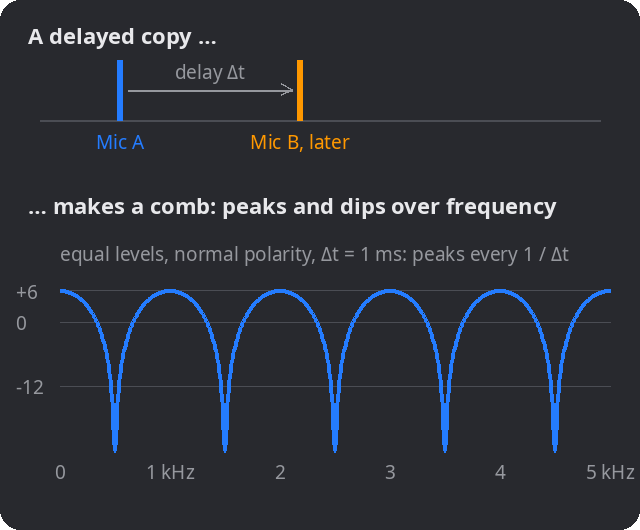
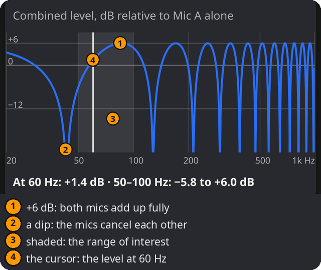
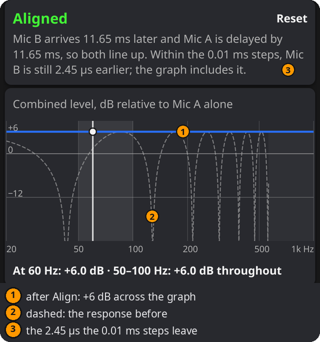

# Zwei-Mikrofon-Summe

Was beim Mischen zweier Mikrofone derselben Quelle in unterschiedlichen Abständen passiert und wie Verzögerung, Pegel oder Polarität das Ergebnis ändern.

## Einsatz

- Bassdrum, Snare oder Verstärker mit Nah- und Raummikrofon: Wird der Bass beim Mischen dünner?
- Zwischen Laufzeitausgleich und Polaritätsumkehr entscheiden.
- Hohlen oder phasigen Klang und die betroffenen Frequenzen verstehen.

## Funktionsweise

Das weiter entfernte Mikrofon hört denselben Schall später. Die Mischung fügt eine **verzögerte Kopie** hinzu. Bei manchen Frequenzen addieren sich die Anteile: **Verstärkung**, bei gleichem Pegel bis +6 dB. Bei anderen liegen sie gegensinnig und erzeugen **Auslöschung**. Dieses regelmäßig wiederkehrende Muster heißt **Kammfilterung**.

*1 ms Verzögerung: Spitzen alle 1000 Hz, Senken jeweils dazwischen. Die Abbildung verwendet englische Beschriftungen.*

Das Muster folgt dem verbleibenden Zeitunterschied Δt: Ankunft von B minus einer Verzögerung auf A, als positiver Wert genommen; früher oder später ergibt dasselbe Muster. Für Δt ungleich null und normale Polarität gilt:

- **Senken** bei 1 ÷ (2 × Δt), danach alle 1 ÷ Δt. Bei 11.65 ms etwa 42.9 Hz, 128.8 Hz, 214.6 Hz …
- **Spitzen** bei Vielfachen von 1 ÷ Δt: 85.9 Hz, 171.7 Hz …
- **Umgekehrte Polarität** vertauscht beide: Die Senken liegen dann bei den Vielfachen von 1 ÷ Δt.
- **Pegel** ändert nur die Tiefe: Ein leiseres B ergibt flachere Senken und kleinere Spitzen bei denselben Frequenzen.

Polarität und Verzögerung sind verschieden. Die Polaritätsumkehr dreht das Signal bei jeder Frequenz um; eine Verzögerung verschiebt es zeitlich und ändert die Phase umso mehr, je höher die Frequenz ist. Eine Polaritätsumkehr hebt deshalb nie eine Laufzeit auf.

Das Diagramm zeigt den **Summenpegel relativ zu Mikrofon A allein**. 0 dB bedeutet bei dieser Frequenz denselben Pegel wie A allein; +6.02 dB ergeben zwei gleiche Anteile im Gleichtakt. Es ist ein Signalpegel bei einer Frequenz, keine Aussage über die Lautheit der ganzen Mischung.

## Bedienung

1. Die Karte **Aufbau** prüfen:
   - **Schallquelle:** typischer Frequenzbereich mit Markierung, etwa Bassdrum 50–100 Hz bei 60 Hz oder Becken 3–12 kHz. **Bereich** und **Frequenz** sind frei änderbar; die Auswahl zeigt danach **Benutzerdefiniert**.
   - **Temperatur**, **Einheiten** und **Samplerate** einstellen.
2. **Mikrofon B gegenüber Mikrofon A** beschreiben:
   - **Weiter entfernt um:** zusätzlicher Abstand von B als Entfernung oder gemessene Zeit in **ms**. Ein Einheitenwechsel rechnet um. Negativ bedeutet, dass B näher steht.
   - **Pegel:** B relativ zu A in dB; 0 bedeutet gleich laut.
   - **Polarität:** Normal oder Invertiert wie am Kanal.
   - **Verzögerung auf A:** auf A angewendete Verzögerung in ms, 0 oder mehr. Kommt B zuerst an, stattdessen B in der DAW verzögern.
3. Änderungen ausprobieren. **Ausrichten** setzt den Laufzeitausgleich für den Direktschall. Pegel und Polarität ändern und das Diagramm beobachten.

Der Bereich muss zwischen 10 Hz und 20 kHz liegen, mit Von unter Bis, die Frequenz der Markierung innerhalb der im Diagramm gezeigten Frequenzen und die Temperatur zwischen −40 und +50 °C. Ist ein Wert nicht verwendbar, nennt die Ankunftszeile den zu korrigierenden Wert, und es erscheint kein Ergebnis.

## Ergebnisse

- **Ankunft:** etwa „Mikrofon B kommt 11.65 ms später an“, zusätzlich als Sampleanzahl. Nach dem Ausrichten steht **Ausgerichtet**. **Reset** entfernt die Verzögerung. Ausrichten setzt die Verzögerung in Schritten von 0.01 ms, daher können einige Mikrosekunden bleiben; die Zeile nennt sie, und Diagramm und Pegel berücksichtigen sie.

*Die Abbildung verwendet englische Beschriftungen.*

- Das **Diagramm** zeigt den Summenpegel über der Frequenz. Der **schattierte Bereich** ist der gewählte Frequenzbereich. Die **Markierung** zeigt die eingestellte Frequenz. Darunter stehen deren Pegel sowie Minimum und Maximum im Bereich.
- Wird der Kammfilter zu fein für eine einzelne Linie, zeigt das Diagramm das **Pegelband**.
- **Erwartete Auslöschung und Verstärkung** listet die ersten drei Senken und Spitzen ab dem Diagrammbereich samt Pegel. Bei dichtem Kammfilter erscheint auch der Abstand. Liegt keine unter 20 kHz, erscheint stattdessen der Pegelbereich im Hörbereich.
- **Auslöschung:** Vollständige Auslöschung erfordert gleiche Pegel und Gegenphase. Der Boden des Diagramms bei −120 dB steht dafür; Pegel unter −60 dB heißen nahezu vollständige Auslöschung.
- **Direktschall ausrichten** nennt den nötigen Ausgleich und das zu verzögernde Mikrofon. Ob es besser klingt, entscheidet das Gehör.

- Bei Verzögerung auf A, anderem Pegel als 0 dB oder invertierter Polarität zeigt eine **gestrichelte Linie** den Ausgangszustand zum Vergleich: beide gleich laut, normale Polarität, keine zusätzliche Verzögerung.

## Praxis

1. Den zusätzlichen Abstand des zweiten Mikrofons messen oder schätzen. Wenn möglich stattdessen den **Zeitversatz** zwischen zwei aufgenommenen Schlägen in der DAW messen und in ms eingeben.
2. Den relevanten **Frequenzbereich** betrachten. Eine Senke etwa bei 60 Hz kann eine Bassdrum dünn klingen lassen.
3. **Die Möglichkeiten im musikalischen Zusammenhang abhören;** keine ist immer richtig:
   - **Aufstellung oder Mikrofonwahl:** Ein Mikrofon zu verschieben oder wegzulassen ändert den Zeitunterschied selbst.
   - **Laufzeit:** Näheres Mikrofon verzögern, damit der Direktschall übereinstimmt. Im Modell verschwindet der Kammfilter für den Direktschall; reale Raumreflexionen haben andere Laufzeiten, und die spätere Ankunft des Raums kann gewollter Teil des Klangs sein.
   - **Polarität:** Umkehren von B vertauscht Senken und Spitzen. Eine Senke kann dadurch verschwinden und eine andere in den wichtigen Bereich rücken.
   - **Pegel:** Leiseres B macht alle Senken flacher, verringert aber seinen Beitrag.
4. **In Mono abhören**, Änderung ein- und ausschalten und dem Gehör mehr vertrauen als dem Diagramm.

## Beispiele

B 4 m weiter entfernt, 20 °C, 48 kHz, Bassdrum 50–100 Hz:

| Einstellung | Ergebnis |
|---|---|
| Gleicher Pegel, normale Polarität | B kommt 11.65 ms beziehungsweise 559 Samples später an. Bei 60 Hz entstehen +1.4 dB, im Bereich 50–100 Hz −5.8 bis +6.0 dB. |
| Ausrichten: A um 11.65 ms verzögern | +6.0 dB im ganzen Diagramm; es bleiben 2.45 µs, die 20 kHz auf +5.9 dB senken. Exakt 11.6475 ms ergäben +6.02 dB bei jeder Frequenz. |
| B bei −6 dB, invertierte Polarität | Senken nur bis −6.0 dB, Spitzen +3.5 dB. Senken verschieben sich zu 85.9 · 171.7 Hz. |
| Gleicher Pegel, invertiert, Ausrichten, Becken 3–12 kHz | Keine vollständige Auslöschung: Die verbleibenden 2.45 µs ergeben bei 6 kHz −20.7 dB. |

## Hinweise

- Das einfache Modell verwendet dasselbe Signal mit Verzögerung, Pegel und Polarität. Raumreflexionen, Mikrofonfrequenzgänge und Richtwirkung fehlen; reale Verläufe sind unregelmäßiger.
- Die vorgeschlagene Ausrichtung ist eine **Hörentscheidung**. Der zeitliche Abstand eines Raummikrofons kann zum gewünschten Klang gehören.
- **Laufzeitausgleich** berechnet Verzögerungen für mehrere Mikrofone. Die **3:1-Regel** prüft das Übersprechen zu einem Nachbarmikrofon.
