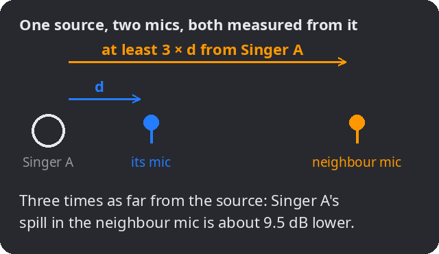
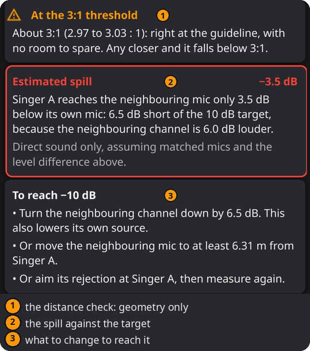

# 3:1 Rule

Does a source spill too strongly into a neighbouring mic? And if it does, how much quieter, or how much farther away, does the neighbouring mic need to be?

## When to use it

- Two singers, two instruments or a choir, each with its own mic.
- Placing a guitar amp and a vocal mic in the same room.
- Any setup where mics for different sources are close to each other and will be mixed together.

## How it works

Every mic picks up some of the other sources too: this is **spill** (or bleed). When a source reaches its own mic and, weaker and later, a neighbouring mic, mixing the two mics adds a delayed copy of that source and causes comb filtering (see **Two-Mic Sum**). The quieter the copy, the shallower the comb.

In a free field, away from walls and from a source that is small compared with the distance, sound pressure falls in proportion to 1 ÷ distance (intensity with 1 ÷ distance²): about **6 dB every time the distance doubles**. Close to large sources and in reverberant rooms it falls less. So the farther the neighbouring mic is from the source, compared with the source's own mic, the quieter the spill:

- **Spill** ≈ 20 × log10(distance to its mic ÷ distance to the neighbour mic) + **neighbour gain**
- At **three times the distance** the spill is about **9.5 dB** lower. That is the classic **3:1 rule**, which keeps the comb shallow in this simple model: at most about +2.5 / −3.5 dB.

Many guides state the rule as mic spacing instead: the mics at least three times as far apart as each is from its own source. That is not the same geometry. This calculator uses the two paths from the source, which set the spill level: with its mic at d and the neighbour mic at 3 × d on a line, the mics are only 2 × d apart; mics 3 × d apart on that line put the neighbour 4 × d from the source, −12.0 dB.

**Neighbour gain** accounts for anything that makes the neighbouring channel louder: more gain or fader, a more sensitive mic, or a pickup pattern that favours this source. It is your own estimate: the calculator doesn't know your mics or faders. It can turn a correct-looking layout into a problem, or rescue one that's too close. It is only the extra channel level: the drop with distance is calculated. In **Two-Mic Sum**, by contrast, Level is Mic B's whole level relative to Mic A; 1 m / 3 m with 0 dB neighbour gain corresponds there to a level of −9.5 dB. Don't enter the distance drop in both places.

## How to use it

1. **Check one source at a time.** Fill in the **Setup** card:
   - **Source**: the source you check, e.g. "Singer A" (optional; the results use the name).
   - **To its mic**: the distance from this source to its own mic.
   - **To neighbour mic**: the distance from the same source to the neighbouring mic.
   - **Neighbour gain**: how much louder the neighbouring channel is, in dB (negative if it's quieter; default 0 dB).
   - **Target**: how far below the spill should be: **3:1 (9.5 dB)**, **10 dB below** or **15 dB below**.
   - **Units**: m or ft.
2. **Read the results**, then repeat for every other source: one source passing doesn't mean the others do.

## Reading the results

- The **distance ratio**: how many times farther the neighbour mic is, e.g. 3.0 : 1.

- **Distance check:** ✓ meets the 3:1 guideline, ! at the threshold (within 1 % of 3:1, 2.97 to 3.03 : 1, no room to spare), or ✕ below 3:1. This looks at the distances only.
- **Estimated spill:** how far below (or above) its own mic the source reaches the neighbouring mic, including the neighbour gain, and whether that meets the target; within 0.05 dB counts as on target.
- **Room to spare** (when it meets the target): how close the neighbouring mic may come.
- **To reach the target** (when it doesn't): turn the neighbouring channel down by the missing dB, move the neighbouring mic to at least the distance shown, or aim its rejection (the back of a cardioid) at the source. These are alternatives; try one, then check again.
- **Comb filtering:** how much the mix could boost and cut at some frequencies, if both copies were otherwise identical. Only equal levels can cancel completely; a spill twice as loud as its own mic or more only boosts, by different amounts at different frequencies.
- **Distances advised** ("at least …", "as close as …") are rounded up to the shown precision, so following them meets the target.
- Values that cannot be used, such as a distance of 0 or a gain that is not a number, give a message instead of a result.

## In practice

1. **Place the mics**, then measure from each source to its own mic and to every other mic that is up in the mix, not only the nearest: a farther mic with more gain can be worse (1 m / 4 m with +12 dB gives −0.04 dB, about as loud as its own mic), and several weak copies add up.
2. **Check each source.** For two singers, check Singer A (its mic and B's mic), then Singer B (its mic and A's mic).
3. **Account for the faders.** If the neighbouring channel is turned up in the mix (a quiet singer, a sensitive mic), enter that as neighbour gain.
4. **Fix the worst case first:** more distance is the most reliable fix; turning down the neighbour also lowers its own source; aiming a cardioid's back at the other source helps most in the mids and highs.
5. **Listen in mono** with both mics up, and finally with the whole mix: a hollow, phasey sound means the spill is still too strong. A pass for each pair does not guarantee the sum of many mics.

## Examples

Singer A:

| Setup | Result |
|---|---|
| 1 m / 4 m, 0 dB, target 3:1 | 4.0 : 1, meets the guideline. Spill −12.0 dB, 2.5 dB better than the target; the neighbour mic may come as close as 3 m. |
| 1 m / 3 m, neighbour 6 dB louder, target 10 dB | At the threshold, but the spill is only −3.5 dB, 6.5 dB short. Turn the neighbour down by 6.5 dB, or move it to at least 6.31 m. |
| 1 m / 2 m, 0 dB, target 3:1 | Below 3:1: spill −6.0 dB, 3.5 dB short. Move the neighbour mic to at least 3 m, or turn it down by 3.5 dB. |
| 1 m / 2 m, neighbour 6 dB quieter | Still below 3:1, but the spill (−12.0 dB) meets the 9.5 dB target. |

## Good to know

- **It's a guideline, not a guarantee.** The estimate covers the direct sound only, with matched mics apart from the gain you entered; reflections and pickup patterns change the real result, and they depend on frequency.
- **A full 10 dB needs 3.16 : 1**, not 3 : 1.
- The rule reduces spill; it doesn't line signals up in time. For that, see **Alignment Delay** and **Two-Mic Sum**.
