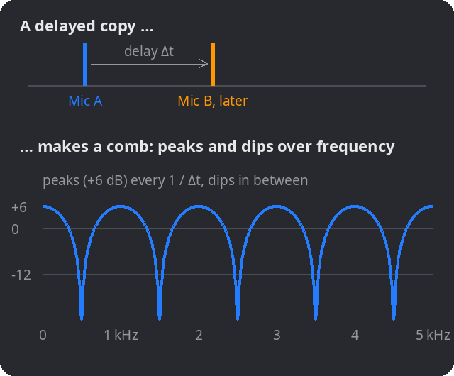
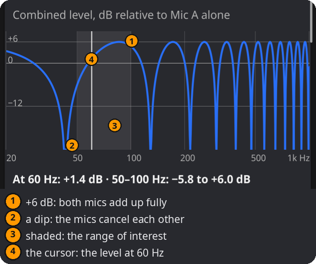
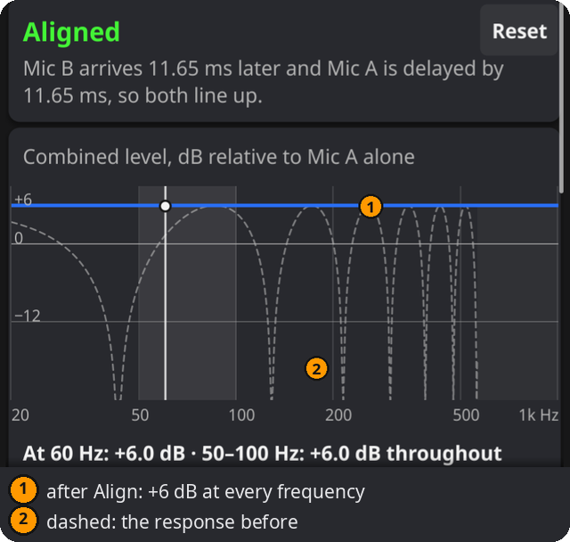

# Two-Mic Sum

What happens to the sound when you mix two mics that pick up the same source at different distances, and what a delay, a level change or a polarity flip would do about it.

## When to use it

- A kick, snare or amp with a close mic and a room or far mic: does the combination thin out the low end?
- Deciding whether to line two mics up in time, or to flip a polarity switch.
- Understanding why two mics sound hollow or "phasey" together, and at which frequencies.

## How it works

When two mics hear the same sound, the farther mic hears it later. Mixing them adds a **delayed copy** to the sound. At some frequencies the two copies are in step and add up: **reinforcement**, up to +6 dB with equal levels. At others they are opposite and cancel: **cancellation**. Because this repeats regularly over frequency, the response looks like a comb, hence **comb filtering**.

*A delay of 1 ms: peaks every 1000 Hz, dips halfway between them.*

The pattern follows from the time difference Δt alone:

- **Dips** at 1 ÷ (2 × Δt), then every 1 ÷ Δt above that. With 11.65 ms: 42.9 Hz, 128.8 Hz, 214.6 Hz …
- **Peaks** at multiples of 1 ÷ Δt: 85.9 Hz, 171.7 Hz …
- **Level and polarity** change the depth and position: a quieter Mic B makes shallow dips and small peaks; an inverted polarity swaps where the dips and peaks are.

The calculator shows this as a graph of the **combined level relative to Mic A alone**: 0 dB means the mix sounds as loud as Mic A on its own; +6 dB means both add up fully.

## How to use it

1. **Check the Setup card:**
   - **Source**: a typical **range of interest** and a frequency for the cursor, e.g. Kick 50–100 Hz with the cursor at 60 Hz, or Cymbals 3–12 kHz. Change the **Range** or **Frequency** to anything; the source then shows "Custom".
   - **Temperature**, **Units** and **Sample rate**.
2. **Describe Mic B compared with Mic A:**
   - **Farther by**: how much farther Mic B is from the source, as a distance, or as a measured time in **ms**. Switching converts the value. A negative value means Mic B is closer.
   - **Level**: how loud Mic B is in the mix compared with Mic A, in dB (0 = equal).
   - **Polarity**: Normal or Inverted, as on the channel's polarity switch.
   - **Delay on Mic A**: a delay applied to Mic A, in ms.
3. **Try changes:** **Align** fills in the delay that lines up the direct sound; adjust the level or polarity and watch the graph.

## Reading the results

- **Arrival:** "Mic B arrives 11.65 ms later" with the samples at your sample rate. After Align it says **Aligned**; **Reset** removes the delay again.

- **The graph** shows the combined level over frequency. The **shaded band** is your range of interest; the **cursor** marks the frequency you set, and the line below the graph gives the level there and the lowest and highest level within the range.
- Where the comb gets too fine to draw as a line, the graph shows the **band** the level swings in.
- **Predicted cancellation and reinforcement** lists the first dips and peaks from the graph's range on, how deep they go, and how far apart they repeat.

- After a change, a **dashed line** shows the response before it, so you can compare.

## In practice

1. **Measure or estimate** how much farther the second mic is from the source than the first. If you can, measure the time difference instead: zoom in on a hit in both tracks and read the offset; enter it in **ms**.
2. **Look at your range of interest.** A dip right in it (e.g. at 60 Hz for a kick) is what makes the combination sound thin.
3. **Try the fixes, in this order:**
   - **Align:** delay the closer mic so the direct sound lines up. This removes the comb for the direct sound.
   - **Polarity:** if a dip sits in the range of interest, flipping Mic B's polarity moves the peaks there instead.
   - **Level:** a quieter Mic B makes all dips shallower, at the cost of its contribution.
4. **Listen in mono**, switching your change on and off. Trust your ears over the graph.

## Examples

Mic B 4 m farther, 20 °C, 48 kHz, Kick 50–100 Hz:

| Setting | Result |
|---|---|
| Equal level, normal polarity | Mic B arrives 11.65 ms (559 samples) later. At 60 Hz the mix is +1.4 dB; within 50–100 Hz it swings from −5.8 to +6.0 dB. |
| Align (Mic A delayed by 11.65 ms) | +6.0 dB at every frequency. |
| Mic B at −6 dB, inverted polarity | Dips only reach −6.0 dB and peaks +3.5 dB; the dips move to 85.9 · 171.7 Hz. |

## Good to know

- **The model is simple on purpose:** the same signal reaching both mics, with a delay, a level and a polarity. Room reflections, the mics' own response and their pickup patterns aren't included, so the real result is less regular.
- **The suggestion is an option, not a rule.** Lining up a room mic removes the comb for the direct sound, but the room's later arrival is often part of the sound you want.
- **Alignment Delay** calculates the delays for many mics at once; **3:1 Rule** checks how strongly a source spills into a neighbouring mic.
